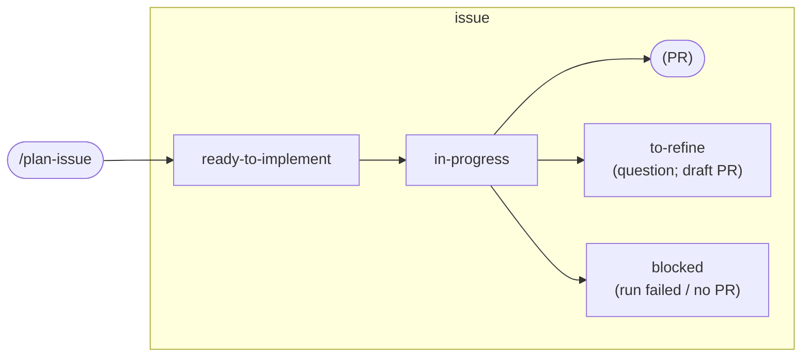
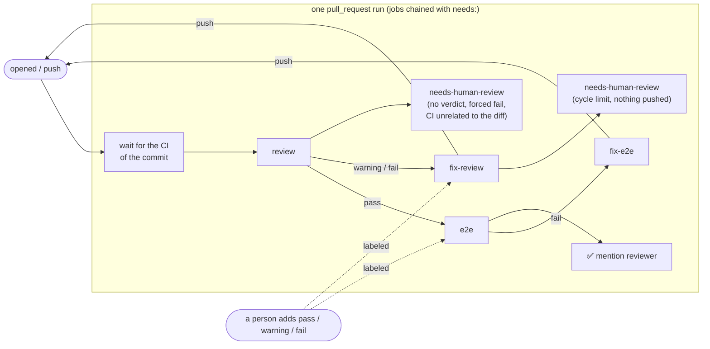

# Architecture

## Components

| File | Kind | Purpose |
|---|---|---|
| `.github/workflows/implement.yml` | reusable workflow | issue with approved plan → branch + PR |
| `.github/workflows/review.yml` | reusable workflow | wait for CI, review a PR, post report, set the verdict label, return the next stage |
| `.github/workflows/fix-review.yml` | reusable workflow | apply the latest report to the PR branch, enforce the cycle limit |
| `.github/workflows/e2e.yml` | reusable workflow | start the app via hooks, test live with Playwright MCP |
| `.github/workflows/mention.yml` | reusable workflow | ad-hoc `@claude` interactions |
| `prompts/*.md` | data | base prompts, rendered by `scripts/render-prompt.sh` |
| `scripts/*.sh`, `scripts/trusted-comments.jq` | helpers | context gathering, plan/report/verdict extraction with trust filter, cycle count, the state after each stage (verdict label, next stage, hand-over to a person), job summary |
| `templates/` | data | caller workflows, prompt extensions, e2e hooks, `/plan-issue` command |
| `tests/` | tests | offline tests of the scripts and the bootstrap, run by `self-check.yml` |

Why it is built this way: [decisions.md](decisions.md).

The consumer repository owns the **triggers** (`on:` + `if:` in the caller) and the
**project knowledge** (`with:` inputs, `.github/patufet/*`). Everything else — prompts,
guards, workarounds — lives here and is picked up by every consumer when the `v1` tag moves.

### How a reusable workflow gets its prompts

A `workflow_call` job runs in the **caller's** context: `github.event`, `github.repository`
and `actions/checkout` all refer to the consumer repository. To reach its own prompts and
scripts, each job downloads this repository's tarball at `job.workflow_repository` /
`job.workflow_sha` (the exact commit of the reusable workflow being executed) into
`$RUNNER_TEMP/patufet` — outside the workspace, so the implementing agent can never
commit it. Prompts are rendered by substituting `{{placeholders}}` and appending the
consumer's extension file, then passed to the action's `prompt` input.

## State machine

Labels drive everything. Names are inputs; the defaults are:

Rules that make it work (decision 11):

- **Claude never sets the state.** It returns its verdict as structured output
  (`--json-schema`), or failing that the marker of the comment posted by *this* run
  (`cycle=N` / `run=ID.ATTEMPT`, never an earlier one, `scripts/read-verdict.sh`). A
  deterministic step then sets the label with `GITHUB_TOKEN` (`scripts/set-verdict-label.sh`).
  Events created with `GITHUB_TOKEN` start nothing, so a label can never start a stage twice.
- **The stages after a review run in the same run.** `review.yml` returns `next-stage`
  (`scripts/route-review.sh`), and the caller's `fix-review` and `e2e` jobs start on it with
  `needs: review`; a failed e2e returns `next-stage=fix-review` to the `fix-e2e` job. Every
  stage shows in the PR's checks.
- **Code changes close the loop through events.** The implementer opens the PR and
  `fix-review` pushes with the Claude App token, whose events do start workflows: `opened` /
  `synchronize` start the next review.
- **People keep moving the flow with labels.** A label a person adds (`labeled`) starts
  `fix-review` or `e2e` alone, in a run of its own.
- `pass`, `warning`, `fail` are **mutually exclusive**. `review.yml` removes them before Claude
  runs, so while a review runs the PR has no verdict label (except a fork PR, whose token is
  read-only).
- **A stage never acts on a superseded commit.** A newer push cancels a review still running.
  A review, e2e or fix-review that finds the PR moved on from the commit it started from sets
  no label and starts nothing: the review of the new commit decides.
- The review waits for the CI of the PR's head commit: every workflow that runs on it for a
  `pull_request` event, except the caller's own (`scripts/wait-for-ci.sh`, decision 12). The
  reviewer gets the result of their jobs and the end of the failed logs (`scripts/ci-section.sh`). A red CI is a `fail`, and there is one review path for it: the
  inline comments and the report go to `fix-review` like any other. If the structured verdict
  is `pass` on a red CI, the workflow forces `fail` and asks a person, since that report asks
  for no change. A failure the reviewer finds unrelated to the diff (`needs_human` in its
  result) gets `fail` and `needs-human-review`, and no fix.
- The review cycle counter is the number of trusted comments carrying
  `<!-- patufet:review`. `fix-review` refuses to run once it reaches `max-review-cycles`
  and labels `needs-human-review` instead (`scripts/fix-gate.sh`).
- A `fix-review` that ends without a push starts no new review, so it also labels
  `needs-human-review` and mentions the reviewer: the PR never stays at `warning` / `fail` with
  nobody told.
- The implementer job fails (and labels `blocked`) when the action ends green without having
  opened a PR or marked the issue `to-refine` — the action can finish "successfully" after
  tool denials without doing anything.

## Markers

Machine-readable HTML comments, invisible on GitHub, independent of the `language` used for
the human text:

| Marker | Written by | Read by |
|---|---|---|
| `<!-- patufet:plan -->` | you (`/plan-issue`) | implement, review, e2e (`scripts/find-plan.sh`) |
| `<!-- patufet:review cycle=N verdict=V -->` | reviewer | review (fallback verdict), fix-review, cycle counter |
| `<!-- patufet:e2e run=ID.ATTEMPT verdict=V -->` | e2e tester | e2e (fallback verdict), fix-e2e (the report to apply after a failed e2e) |

Only comments by `OWNER` / `MEMBER` / `COLLABORATOR` authors or by the `claude[bot]` /
`github-actions[bot]` bots are considered (see [security.md](security.md)).

## Concurrency

| Workflow | Group | Cancel in progress |
|---|---|---|
| implement | `patufet-implement-<repo>-<issue>` | no (a running implementation is never killed) |
| fix-review (and the caller's fix-e2e job) | `patufet-implement-<repo>-pr-<pr>` | no (a fix in progress finishes; one that finds the PR moved on does nothing) |
| review | `patufet-review-<repo>-<pr>` | yes (a review of a superseded diff must not label after a newer one; a new push also ends the wait for the previous commit's CI) |
| e2e | `patufet-e2e-<repo>-<pr>` | yes |

Different issues / PRs run in parallel. Jobs that `need` a cancelled review are skipped, so a
superseded review never starts fix-review or e2e.

## Cost

Per issue, in Claude runs (each bounded by `max-turns`):

- 1 × implement (`max-turns` 400 by default; a medium full-stack issue used ~200 turns in
  practice, a small one far fewer).
- 1 × review per push to the PR (default `max-turns` 400).
- up to `max-review-cycles − 1` × fix-review, fix-e2e included (default limit 10 → at most 9
  fix runs).
- 1 × e2e per `pass` (optional, default `max-turns` 200).

Levers: `max-review-cycles`, `max-turns`, `model` (e.g. a cheaper model for review), keeping
issues small (the plan gate is the real cost control), and not enabling e2e until the rest is
stable. There is no hard budget per run in the action; `max-turns` is the only cap.

## Observability

Every job writes a summary (the run page on GitHub): outcome, turns, duration and the cost
Claude Code reports for the run, plus the verdict and cycle. With an OAuth token the cost is
what the run would cost on the API, not what the subscription is charged.

## Testing

The workflows cannot run locally (`act` cannot run the Claude action). What is verifiable,
all run by `self-check.yml`:

- `actionlint` on the reusable workflows and on the caller templates, `shellcheck` on the
  scripts.
- `tests/run.sh`: the scripts (trust filter, verdict, plan, linked issue, labels, prompt
  rendering), the bootstrap's idempotence, and the consistency of prompts, workflows and
  docs, offline with a stubbed `gh`.
- Real behaviour: a full cycle on a sandbox repository (see
  [CONTRIBUTING.md](../CONTRIBUTING.md#checking-a-change)).
